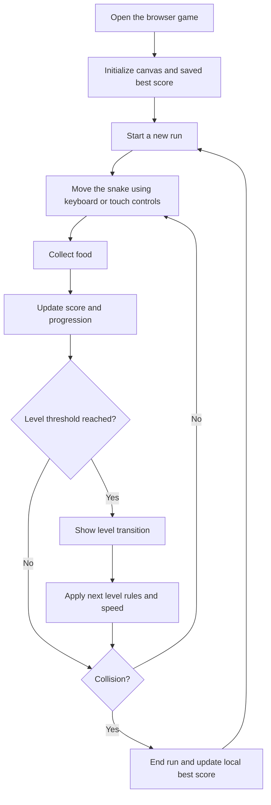

# SNAKE GAME — V2

**A responsive, multi-level Snake game for desktop and mobile browsers.**

A Canvas-based learning project with progressive difficulty and touch controls.

---

## Overview

Snake Game v2.0 extends the classic grid-based Snake experience with a responsive playfield, a five-level progression model, score persistence, and dedicated touch controls for mobile devices.

## Features

- HTML Canvas-based game rendering.
- Five progressive difficulty levels.
- Increasing movement speed as the player advances.
- Wall wrapping on Levels 1–3 and wall collision on Levels 4–5.
- Score, current level, speed, and best-score display.
- Persistent best score using browser localStorage.
- On-screen directional pad for touch devices.
- Level transition panel and restart-oriented gameplay flow.
- Visual particle effects and responsive canvas sizing.

## Game flow

## Technology

- HTML5
- CSS3
- Vanilla JavaScript
- HTML Canvas 2D API
- Browser localStorage
- Node.js and Express for local serving

## Requirements

- Node.js and npm.
- A modern desktop or mobile browser.

## Getting started

    git clone https://github.com/gusti111/snake-game-v2.0.git
    cd snake-game-v2.0
    npm install
    npm start

Open the local URL served by server.js.

## Repository structure

    snake-game-v2.0/
    ├── public/
    │   ├── index.html
    │   ├── game.js
    │   ├── style.css
    │   └── assets/
    ├── server.js
    └── package.json

## Project status and limitations

An intermediate browser-game project focused on progression, responsive layout, and mobile input. Best-score data is stored in the current browser profile and is not synchronized between devices.

The current package manifest does not define an automated test script. The repository also contains node_modules; generated dependency folders should be removed from source control and restored with npm install.

## Author

**Gusty Faqikh** · [GitHub](https://github.com/gusti111)